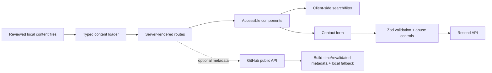

# Architecture

## Planned stack
- Next.js App Router + TypeScript strict.
- Tailwind CSS with design tokens from `DESIGN.md`.
- File-backed typed content (MDX/JSON/TS modules); no database for v1.
- Zod for API and content-boundary validation.
- Resend for contact email delivery, if account/domain constraints are resolved.
- Vercel for hosting and optional Vercel Analytics.
- Lucide icons only.
- Vitest for focused unit tests; Playwright for critical-path smoke test if setup time permits.

## Planned folder structure
```text
app/
  (site)/page.tsx
  projects/page.tsx
  projects/[slug]/page.tsx
  writing/page.tsx
  writing/[slug]/page.tsx
  about/page.tsx
  cv/page.tsx
  contact/page.tsx
  api/contact/route.ts
  not-found.tsx
components/
  layout/  projects/  writing/  cv/  ui/
content/
  projects/  articles/  profile.ts  experience.ts  credentials.ts
lib/
  content/  validation/  integrations/  seo/
public/
  icons/  images/  cv/
tests/
brain/
```
This is planned structure, not existing code.

## Data flow


## Routes
| Route | Purpose | Rendering |
|---|---|---|
| `/` | Home, identity, featured projects | Server-rendered |
| `/projects` | Search/filter project directory | Server + small client filter |
| `/projects/[slug]` | Project case study | Static/ISR where supported |
| `/writing` | Article directory | Server-rendered |
| `/writing/[slug]` | Article | Static |
| `/about` | Profile, experience, education, credentials | Server-rendered |
| `/cv` | CV page, PDF and print | Server-rendered |
| `/contact` | Contact information/form | Server-rendered + client validation |
| `/api/contact` | Validated contact submission | Server route |
| `/sitemap.xml`, `/robots.txt` | Search engine discovery | Generated |
| `not-found` | Helpful 404 | Static |

## Authentication flow
No user authentication is needed. Portfolio visitors do not create accounts. Contact form identity is not trusted; treat all submitted fields as untrusted input.

## Components/services
- Layout: header, navigation, footer, theme toggle, skip link.
- Projects: project card, filter/search bar, case-study sections, evidence links.
- Writing: article card, category chips, table of contents, related projects.
- CV: verified content view, PDF download, print stylesheet.
- UI: button, input, card, modal, toast, table, empty state, skeleton, error state.
- Integrations: Resend contact delivery; optional GitHub metadata; Vercel Analytics.

## Code conventions
- TypeScript strict; avoid `any`.
- Feature-based folders and predictable naming.
- Zod validation at boundaries.
- One typed API error format: `{ error: { code, message, requestId? } }`.
- No hardcoded colors; use design tokens only.
- Keep server-only keys in server modules; do not import secrets into client components.
- Keep external API results optional and gracefully degraded.
- Content schema changes require content validation tests.

## Performance strategy
- Prefer server components and static rendering.
- Client components only for interactions requiring browser state.
- Avoid heavy animation and third-party UI bundles.
- Optimize images and provide explicit dimensions.
- No runtime LLM/model inference in the portfolio.
