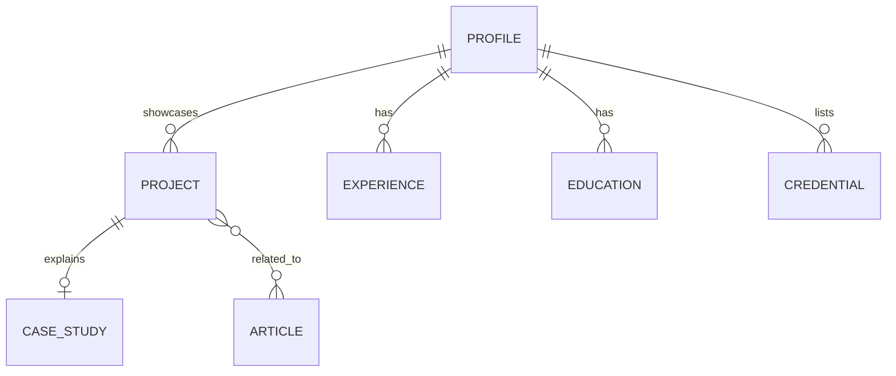

# Data Model

## Decision
Version-controlled content files are the source of truth. No SQL/NoSQL database is justified for the first release; no user accounts or persistent visitor data are required.

## Entities
| Entity | Key fields | Relations |
|---|---|---|
| Profile | name, headline, summary, location (approved), public links | Owns experiences, education, credentials |
| Project | slug, title, summary, category, stack, status, role, repo URL, demo URL, featured | Has case study and evidence links |
| CaseStudy | project slug, problem, approach, architecture, evaluation, limitations, lessons | Belongs to one Project |
| Article | slug, title, excerpt, date, tags, body, reading time, status | May link to Projects |
| Experience | organization, role, dates, bullets, evidence/source | Belongs to Profile |
| Education | institution, program, dates, verified details | Belongs to Profile |
| Credential | title, issuer, issue date, credential URL/ID only if public and approved | Belongs to Profile |
| ContactSubmission | name, email, message, timestamp/request ID | Transient; sent to email provider, not stored by default |
| ExternalRepository | repository URL, language, description, updated date | Optional enrichment of Project |

## Relations

## Validation and indexes
- `slug`: lowercase kebab-case, unique.
- Project/article slugs must be unique and URL-safe.
- Required text fields must be non-empty and within bounded lengths.
- External URLs must use HTTPS unless localhost in development.
- Category/tag filtering uses normalized string arrays; no database indexes needed.
- Content loader should validate all records at build/test time.
- Optional GitHub metadata should be keyed by repository full name and cached/revalidated.

## Access and RLS
- No database tables, authentication, or RLS in v1.
- All committed content is public by design; review before publishing.
- Contact messages are not persisted in the application database.
- If a database is introduced later, stop and obtain approval; define RLS policies and retention/deletion rules first.

## Seed/demo data plan
- Use verified profile content and a small set of confirmed repositories.
- Never create fake portfolio projects or fake evaluation metrics as seed data.
- Placeholder project records may be used only in local development and must be visibly labelled `DEMO / PLACEHOLDER`, excluded from production.
- Demo walkthrough should use real approved projects and stable links.
